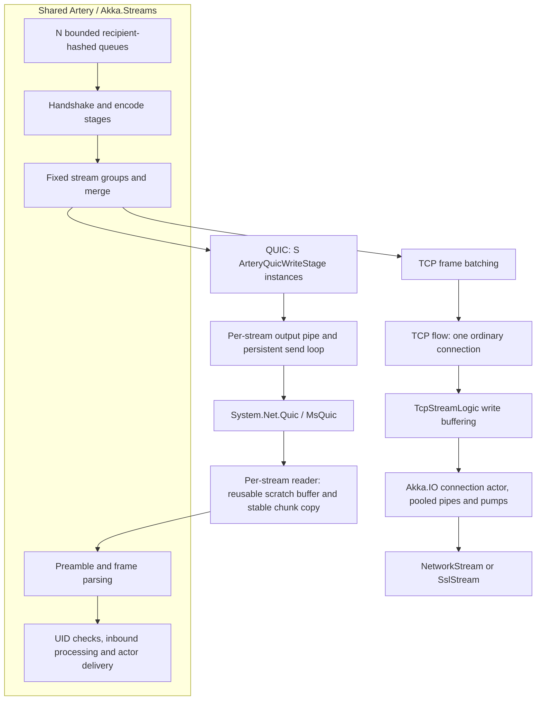
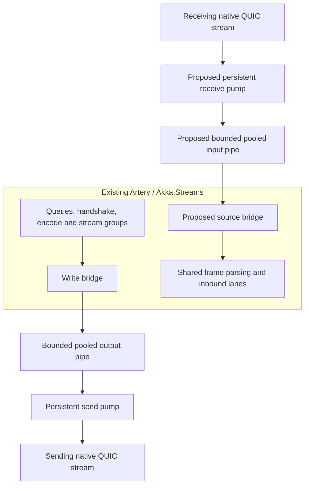
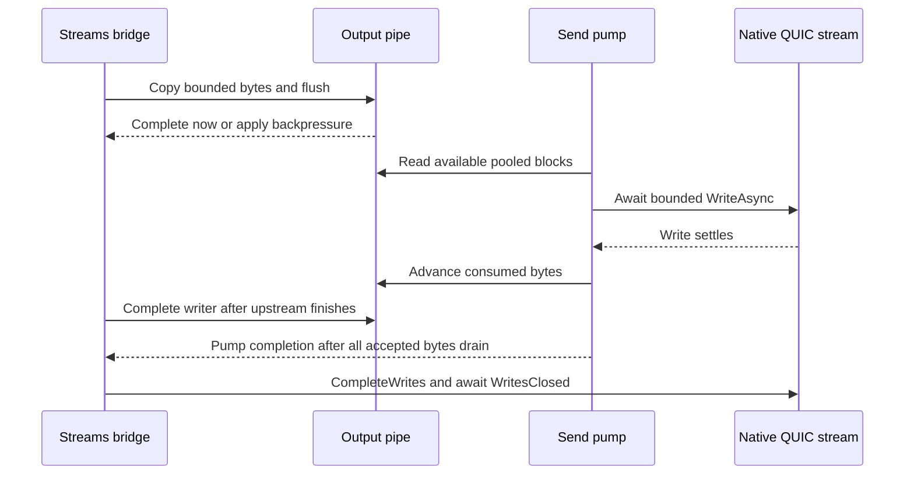

# Artery QUIC prototype

## Scope and status

The prototype adds native QUIC I/O below Artery's existing Akka.Streams graphs. It is experimental:
performance tuning and broader correctness/resource gates remain open. TCP remains the default.
This specification includes no benchmark results or machine-specific execution records.

No Aeron interoperability, HTTP/3, QUIC datagrams, 0-RTT actor traffic, connection migration,
compression implementation or production support commitment belongs to this change.

## Current architecture

Processing lanes and native streams are different quantities. Let N be the number of outbound
processing lanes and S the number of ordinary QUIC streams. Require `1 <= S <= N`, with S at most
64. A recipient keeps its existing hashed lane, and lane i writes to stream `i % S` throughout a
connection generation. Complete frames are grouped; messages are not striped round robin.

TCP keeps its existing merge/batching path. QUIC groups reuse the same handshake, encode,
test-mode and kill-switch stages. A group consumes completion markers from all its lane producers
so its MergeHub can finish, drain queued frames and send FIN.

The ordinary QUIC adapter copies frames into a per-stream output pipe. A persistent loop submits
one native write at a time, capped at 16 KiB. Pipe flush completion controls upstream demand.
The pipe replaces the separate QUIC frame batcher. Control and large-role streams retain direct writes.
Its read path reuses a scratch array and publishes a separate copy of the actual bytes received.
That copy is necessary because frame parsing and asynchronous consumers can retain chunk memory.

## Responsibility and ownership

| Responsibility | Owner |
|---|---|
| Routing, queues, serialization, envelope framing and metadata/compression extension points | Shared Artery graphs |
| Address/UID handshake, reliable system messages, quarantine and retries | Shared association/protocol state |
| Native connect/listen, stream admission, channel failures and final disposal | `ArteryQuicTransport` |
| Graph demand, producer flush completion and encoded-buffer ownership | `ArteryQuicWriteStage` |
| Ordinary byte accumulation, pooled storage and serial native writes | `ArteryQuicOutputPipe` |
| Certificates, trust and peer identity | Existing Akka.IO policies through typed Artery TLS setup |
| TLS packet protection, congestion and native stream credit | `System.Net.Quic` / MsQuic |

Ordinary encoded owners are returned once copying and producer flush work settle. Large frames
copy incrementally so a pending flush does not copy the whole frame into the pipe. Pipe storage
remains live until native writes settle. Direct-write owners remain live through their native write.
Cancellation must not return memory while an asynchronous operation can still use it. The
connection owner disposes native streams; individual graph stages signal retirement rather than
independently competing to dispose a shared connection.

## Connections, framing and failure

- Each node lazily owns one outbound QUIC connection per peer; reverse traffic uses the peer's
  independently dialed connection. There is no simultaneous-dial arbitration or shared bidirectional
  connection ownership in this prototype.
- Control, ordinary and optional large traffic use long-lived unidirectional streams. Ordinary
  admission has a separate configurable cap; duplicate control/large roles are rejected.
- Every stream starts with the existing five-byte Artery role preamble and then the existing
  length-prefixed envelope bytes. Native stream IDs are not Artery role IDs.
- Authentication and admission have deadlines. Accepted and outbound connection counts have finite
  limits. An unsupported platform, missing native library, incompatible protocol or unusable identity
  fails visibly; there is no TCP/plaintext fallback.
- A channel reset/failure retires its directional connection, cancels siblings and fences the old
  generation. A healthy FIN must allow sibling streams to finish independently.
- Ordinary messages gain no application-level replay or exactly-once promise. System-message
  reliability remains the shared protocol's responsibility.
- Local completion drains the pipe before FIN and awaits `WritesClosed`. These signals do not prove
  peer consumption. Connection shutdown can discard unread peer bytes; a bounded peer acknowledgment
  barrier remains necessary for a full peer-drain guarantee. Actor processing is a separate boundary.

## TLS and compatibility

Reuse `TlsCertificateLoader`, `TlsPeerPolicy`, `ArteryTlsSettings` and `ArteryTlsSetup` semantics.
Create role-appropriate native authentication options, require TLS 1.3 and prototype ALPN
`akka-artery-quic-prototype-v1`, and retain pin/custom/system trust and explicit name checks.
QUIC provides native TLS protection; it is not wrapped in an `SslStream`. Caller-owned certificates
must outlive all participating actor systems and their native I/O.

Keep canonical `akka://` addresses. All nodes must explicitly select compatible QUIC configuration;
this is not a rolling TCP-to-QUIC migration mechanism. Use a supported serviced runtime/native pair.

Telemetry and actor-ref/manifest compression belong above the adapter. Future compression-table
advertisements must be acknowledged as installed before any independent ordinary stream uses them.
Control-stream write completion alone does not establish installation. Incarnation changes must
invalidate shared table state consistently across all streams.

## Processing and comparison budgets

Artery creates its inbound consumers per accepted ordinary channel. Configuring N consumers on
each of N QUIC streams would create N squared receive paths. The comparison driver instead pairs
N TCP consumers with S QUIC streams having N/S consumers each, requiring divisibility for that sweep.
The primary sweep uses N=S=1/2/4/8 and one inline receive path per QUIC stream.

These are configured path budgets, not identical scheduling or buffering: one inbound lane processes
inline, while multiple lanes use bounded channels. Match the total outbound queue capacity by dividing
it across processing lanes. Record actual stream counts and recipient occupancy separately; do not
infer utilization from configuration alone or claim all native buffering is equivalent.

RemotePingPong preserves legacy commands and adds explicit DotNetty TCP, Artery TCP, Artery TLS TCP
and QUIC modes. Use the same realistic payload and serializer for paired comparisons. The encrypted
comparison is Artery TLS TCP versus QUIC; plaintext transports are references. Keep ping-pong and
credit-paced one-way units separate. Optional diagnostics report process CPU/allocation/GC and
ordinary QUIC I/O operations; they are separate from unprofiled throughput measurements.

## Output pipe experiment and proposed receive follow-up

The output pipe is implemented on this experiment branch. Its initial pause/resume thresholds are
16 KiB / 8 KiB. A threshold triggers backpressure rather than imposing a hard allocation cap: include
one bounded copy overshoot, physical page slack, original frame ownership and upstream queues in
retention accounting. No timer delays an idle write. Receive pipes below are a proposed follow-up;
the current reader still publishes stable copied chunks. This architecture carries no performance claim.

The source bridge must publish stable bytes before advancing its pipe reader. The write bridge can
return original owners after copying their bytes; the send pump advances only after its native write
settles. Bound native write chunks as well as pipe payload. MsQuic can buffer whole requests past
its connection-wide target, so a managed pipe threshold is not a native memory cap.

`ITransportConnection` provides useful copy/flush and pump-completion semantics, but the concrete
`TcpTransportConnection` also owns socket/TLS shutdown behavior. Do not wrap a fake socket around
QUIC. The experimental directional helper stays internal to Artery, leaving TCP I/O unchanged;
shared pump extraction requires its own regression evidence. No per-stream actor is necessary.

Primary references: [Kestrel QUIC stream pumps](https://github.com/dotnet/aspnetcore/blob/v10.0.0/src/Servers/Kestrel/Transport.Quic/src/Internal/QuicStreamContext.cs),
[MsQuic execution model](https://microsoft.github.io/msquic/msquicdocs/docs/Execution.html), and
[versioned native send buffering](https://github.com/microsoft/msquic/blob/v2.6.3/src/core/send_buffer.c).
Multiple streams provide independent ordering/credit, not automatic native CPU parallelism:
one MsQuic connection and its streams execute on one native worker at a time.

## Delivery

1. **Current prototype:** native adapter, fixed ordinary-stream groups, shared TLS policy, comparison
   source, optional diagnostics, and native correctness tests. Keep TCP/default behavior unchanged.
2. **Ordinary output pipe experiment:** a working bridge and send loop together with retained-byte,
   poisoned-owner, cancellation, saturation/resume and actual writer-drain tests. Include empty,
   single-lane, control and large paths. Preserve connection retirement and FIFO. Receive-pipe ownership
   and peer-acknowledged shutdown remain separate work.
3. **Performance/reliability evaluation:** warmed repeated comparisons, matched effective budgets,
   separate diagnostics and explicit invalid attempts. Native resource, lost-ACK/quarantine,
   percentile-latency and two-host/impairment gates need their own evidence before promotion.

Run the affected Artery, API approval and scoped incremental checks for code changes, plus strict
OpenSpec validation. Unsupported/skipped native tests are not native passes. Keep benchmark
execution separate from builds/tests/profiling. No performance result or default switch follows
from compilation, unit tests or this proposed architecture alone.
